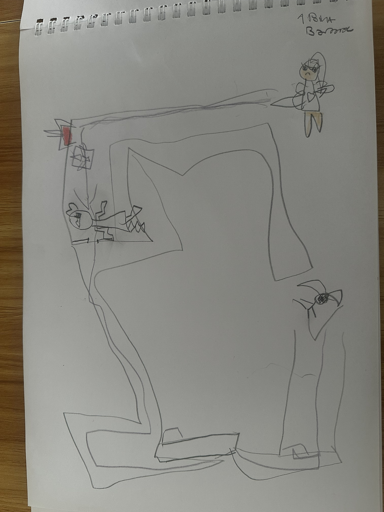

# Mazoole ✏️

**Mazes drawn by hand, played together.**

Mazoole started as pencil drawings in a spiral notebook, made by a parent and
daughter together. This repo turns those drawings into a small co-op browser game that
keeps the look of the notebook: wobbly pencil walls, crayon colors, stick-figure
heroes.



## Play

Open `index.html` in a browser. There's no install and no build step. Double-clicking the file works.

**Online:** every push to `main` copies the site to the `gh-pages` branch, and GitHub
Pages serves it at `https://<owner>.github.io/<repo>/`. One-time setup: in the repo, go to
**Settings → Pages → Build and deployment**, choose **Deploy from a branch**, and pick
`gh-pages` / `(root)`. On a free GitHub plan the repository must be public for Pages to work.

| Who | Keys | Tablet / phone |
|---|---|---|
| **Hero** (player 1, red cape) | `W` `A` `S` `D` | left pad |
| **Fairy** (player 2, butterfly wings) | arrow keys | right pad |
| Restart the level | `R` | ↺ button |
| Menu | `Esc` | ☰ button |

In 1-player mode, both the arrow keys and WASD move the hero.

**Goal:** reach the gift (or rescue the friend in bed). If *either* player gets
there, you both win. You share 5 hearts.

| Thing | What it does |
|---|---|
| 🔴 button in a picture frame | Step on it and the door of the same color opens for good |
| 🟡 key | Opens one scribbled lock door |
| 🦋 wings | Fly over walls for 6 seconds. A ring shows the time left and turns red near the end. Flying also keeps you safe from traps, monsters and spiders |
| ⭐ star | Bonus. Some are sealed inside boxes, so you need wings to reach them |
| 💔 staircase with a broken heart | Trap. Costs a heart unless you fly over it |
| Spiky green monster, spider | Walk back and forth. Dodge them using the side nooks |
| Angry fairy | Shoots a sparkle beam down her corridor. A dotted line warns you before she fires. Wait in a nook and then run! |
| 🍬 candy | 10 points. Grab them quickly one after another for a combo, up to ×5 |
| 🧊 ice | You slide until something stops you. Plan your slides! |
| 🌀 portals `3`–`9` | Step on one and pop out of the other portal with the same number |
| 👻 ghost | Chases whoever is closest, but only when you're near. Flying keeps you safe. After catching someone it goes home and sleeps for a moment |
| 🟪 purple plate | Opens every purple gate, but **only while someone stands on it**. Flying doesn't count. Level 4 needs both players to take turns |

## What we saw in the drawings

The **castle drawing** (`drawings/castle-rescue.jpg`) became level 3, *Rescue in the Tower*:
- The caped stick figure at the bottom left is **the hero** and the starting point.
- The girl lying on the bed in the tower is **the friend to rescue**, which is the goal.
- The smiling girl holding something yellow gives you **the key**. The scribbled
  door beside her is **the lock**.
- The staircase with the broken heart became the **broken-heart traps**.
- The box with a square inside became the **sealed star box**. You need wings to get in.
- The girl flying near the top gave us **the wings power-up**.
- The big angry fairy on the right became the **fairy who shoots a beam**.
- The little framed picture in the corner became the **button** that opens the red door.

The **long corridor drawing** (`drawings/bina-corridor.jpg`) became level 2, *Bina's Corridor*:
- The red door with the present at the end is **the gift** (the goal).
- The spiky creature with teeth is **the monster**. The spider on the right is **the spider**.
- The angry fairy's long line aimed along the top is **the beam**.

Level 1, *Pencil Practice*, is a short tutorial that teaches each item once.
Level 4, *Two Friends, One Plate*, is a two-player puzzle built around the purple plates.

The newer levels each show off one idea:

| Level | Idea |
|---|---|
| 5. Candy Trail | A candy maze with a chasing ghost. Collect the key and escape through the loops |
| 6. Slippery Pond | An ice puzzle. The gift needs 7 planned slides |
| 7. Portal Party | Four rooms with no doors between them, connected only by numbered portals |
| ★ The Fairy Queen's Castle | The secret level. It unlocks at 12 medals and combines ice, portals, a ghost, traps and the fairy's beam |

## 🔦 Treasure hunt (AR)

Open the game from its **https** link (the GitHub Pages address) on a phone, then Menu → **🔦 Treasure hunt**.
The camera doesn't work from a file you double-click. Choose how many treasures (3–6) and one of two hunts:

### ✨ Magic hunt: play alone, no cards

Treasures hide in the air all around you. Hold the phone up and turn around slowly: the camera
shows the room and the treasures float in it, each in its own spot. A big yellow arrow points to the
nearest one. Turn until it floats into the dashed circle and hold it there for a moment, or just tap
it. A cheeky ghost drifts around too. Tap it and it flies away.

It uses the phone's motion sensors to know where you're pointing. Without them (on a laptop, for example)
you drag the screen to look around, and without a camera the treasures hide on notebook paper.

### 🗺️ Card hunt: a grown-up hides real cards

1. **🖨️ Print cards**: all six fit on one page (A4 or Letter), whatever margins the phone adds. Cut them out.
   No printer? Show a card on a laptop or TV screen and that works too.
2. Hide them: under a cushion, behind a door, next to a picture frame…
3. Optional: under **🎤 Record a clue**, say where each card is hidden ("Look under the big table!").
   The clue for the next card plays when the hunt starts and after each find. 🔊 plays it again.
4. Press **Start the card hunt** and hand the phone over.

When the camera sees a card, its treasure pops out on top of the paper, the fairy flies around it,
the phone buzzes, and the treasure flies into the bag at the top. The bottom of the screen shows a
picture of the next card, so no reading is needed. Cards can be found in any order.

How it works: each card has a small QR code (`MAZOOLE:1` … `MAZOOLE:6`) inside a gold picture
frame. Android Chrome reads QR codes itself (`BarcodeDetector`), so nothing extra loads there.
Other browsers load the bundled [jsQR](https://github.com/cozmo/jsQR) fallback
(`js/vendor/jsQR.js`, Apache 2.0) only when a card hunt starts.

### Saved progress and the 🎒 power bag

- A hunt you stop halfway is saved. The setup screen then offers **Continue (2 of 4 found)**.
- Every treasure found (in either hunt) goes into the **power bag**, shown in the menu. While playing a
  maze, the powers sit at the top of the screen. Tap one to use it:

| Power | What it does |
|---|---|
| ⭐ Star | Nothing can hurt you for 7 seconds (you glow gold) |
| 🔑 Key | An extra key for a lock door |
| 🦋 Wings | Fly over walls for 6 seconds |
| 🍬 Candy | 50 points |
| ❤️ Heart | One more heart (up to 7) |
| 🎁 Magic gift | Opens every colored door |

Finishing a hunt gives the *Treasure Hunter* sticker. Finding all six in one hunt gives *Super Seeker*.

## 🦆 Quack Hunt (AR)

Pencil ducks fly around your room. Menu → **🦆 Quack Hunt** → **Start**, then hold the phone up and
turn around to find them (a yellow arrow shows the way). When a duck is in the circle, the circle turns
red: press the big **🎯 Shoot** button (tapping the screen works too). A game has 10 ducks, two at a time,
with 4 shots for each pair. Ducks fly away if you're too slow or out of shots, and they get a little
faster each wave. Catching ducks in a row doubles and then triples the points.

**Records** are saved in the browser: the most ducks in one game, the best score and all ducks caught.

**Secrets** 🤫 (the start screen gives a hint for each one until it's found):

| Secret | How |
|---|---|
| The Golden Duck | Sometimes a shiny golden duck flies by: 500 points and a ⭐ for the power bag |
| The Ceiling Owl | Look straight up and shoot the sleeping owl |
| The Floor Frog | Look straight down and shoot the hiding frog |
| Earthquake! | Shake the phone: every duck gets dizzy and slow for a few seconds |
| Two with One | Catch two ducks with one shot |
| Perfect Ten | Catch all 10 ducks: a 🎁 for the power bag, and from then on ducks are sometimes rainbow-colored |

It uses the same look-around engine as the magic treasure hunt (camera + motion sensors, or drag to look
around). Stickers: *Duck Catcher* (10 ducks), *Sharp Eye* (all 10 in one game), *Secret Keeper* (3 secrets).

## 🔊 Sounds

Every game has its own sound effects, made in the browser with WebAudio (no sound files):
a soft click on buttons; in the mazes a key jingle, door creak, "bonk", fanfare and sad trombone; in
the treasure hunts a sparkle, whoosh and plop for each treasure, rising ticks while you hold one in the
circle, a ghostly "boo", and a sonar ping from the **left or right speaker** that tells you which way
to turn. In Quack Hunt the ducks flap and quack from the side they're on (so you can hear where they
are), and there's a pop, a falling whistle and a magic chime for secrets. Your own recordings from
**🎤 Our sounds** still win, and **♪** turns everything off. The sounds live in `js/sounds.js`.

## Points, medals and stickers

- **Points:** candy 10 (×combo), star 100, key/button/unlock 25, wings 15. Points pop up where you grab them.
- **The score sheet** at the end adds a time bonus (10 points for every second under the clock), 50 for each heart left, and 300 if nobody said ouch.
- **Three medals per maze**, shown on the intro card before you start: ① finish ② collect every star ③ beat the clock. Medals stay earned, so you can go back for the one you missed.
- **Best scores and medals** show on each level card. The total medal count unlocks the secret level.
- **Sticker book:** 19 stickers, such as *Untouchable*, *Candy Combo*, *Ghost Buster*, *Ice Skater*, *Portal Hopper*, *Best Friends* and *Treasure Hunter*. A new sticker pops up the moment you earn it.

Everything is saved in the browser you play in.

## Make your own maze

**In the game:** open the menu and choose **✏️ Draw your own maze**. Pick a tool
and paint with the mouse or a finger, then press **Play it!**. Your maze is saved in the
browser and appears in the menu. Press **Copy level** to get its text.

**From a photo:** in the maze painter, press **📷 From a photo** and pick a picture
of a drawing. Mazoole finds the paper, turns the pencil lines into walls, and puts
the hero and the goal as far apart as it can. The result is a rough draft: the photo stays
faintly underneath, so you can trace over it. Paint the missing walls, erase stray
ones, and add doors and monsters. The **Lines** slider sets how faint a line can be
and still count as a wall.

**Your own sounds:** in the menu, press **🎤 Our sounds** to record a short clip
for each moment: key, star, button, lock, wings, ouch, hooray and "oh no". If
the microphone isn't allowed, upload a sound file instead. Sounds are saved in
this browser only.

**In code:** every level is a small text drawing in [`js/levels.js`](js/levels.js),
one character per square:

```
#  wall             .  floor           1  hero start      2  fairy start
G  goal             a b c  buttons     A B C  doors (same letter)
k  key              L  lock door       w  wings           *  star
h  heart trap       m  monster         s  spider          F  angry fairy
x  purple plate     X  purple gate (open only while someone is on a plate)
+  candy            ~  ice             3-9  portal pairs   g  ghost
```

Optional level settings: `par: 40` sets the seconds for the clock medal (otherwise it's
worked out from the maze), and `bonus: 12` hides the level until 12 medals are collected.

Add `coop: true` to a level that needs two players.

Paste a copied level into the `MAZOOLE_LEVELS` list and it shows up in the menu.

## How it's built (for grown-ups)

It's plain HTML, CSS and JavaScript, with no framework, no build step and no dependencies apart from one Google Font (and the jsQR fallback for the treasure hunt, kept in `js/vendor/`). The renderer falls back to Comic Sans if the font doesn't load.

| File | Job |
|---|---|
| `js/draw.js` | Pencil-style drawing: wobbly strokes, crayon fill, every sprite. Characters "boil" (redraw with new wobble) 6× a second, like hand-drawn animation. |
| `js/levels.js` | The levels as text maps |
| `js/game.js` | Grid movement, buttons and doors, keys, wings, monsters, fairy beams, hearts, co-op input, touch pads, sound effects (small WebAudio beeps, no audio files) |
| `js/editor.js` | The in-game maze painter |
| `js/photo.js` | Photo → maze: finds the paper, detects pencil lines with a local-contrast threshold, snaps them to a grid |
| `js/voices.js` | Records and plays your own sound effects |
| `js/progress.js` | Medals, best scores and the sticker book |
| `js/hunt.js` | The treasure hunt: printable cards, camera, QR reading, the magic look-around hunt (motion sensors), clues, saved progress |
| `js/sounds.js` | All the sound effects, synthesized with WebAudio (some panned left/right) |
| `js/ducks.js` | Quack Hunt: the duck drawing, waves, shooting, records and secrets |
| `js/powers.js` | The power bag: saves found treasures and shows them as power buttons while playing |
| `tools/bundle.py` | Packs everything into one HTML file, for sharing a single file |

Design choices:
- **Movement is tile by tile, animated smoothly.** Collisions stay simple and exact, it's easy for young players, and levels can be written as text.
- **Buttons stay pressed** so the game works for one player. Co-op comes from splitting up: one player dodges the monster while the other goes for the key.
- **No softlocks.** If the wings run out over a wall, you drift down to the nearest floor. If you land in a sealed room, you float back to where you picked up the wings.

### Deploy
The site is static, so any static host works. On GitHub Pages, go to Settings → Pages, choose "Deploy from branch" and pick the branch.

## Ideas for next time
- Smarter photo reading: recognize drawn doors, stars and creatures and place them automatically.
- More powers: shrink to fit through cracks, a lantern for dark mazes, a time-freeze.
- Share a maze with a link, so friends can play it on their own devices.
